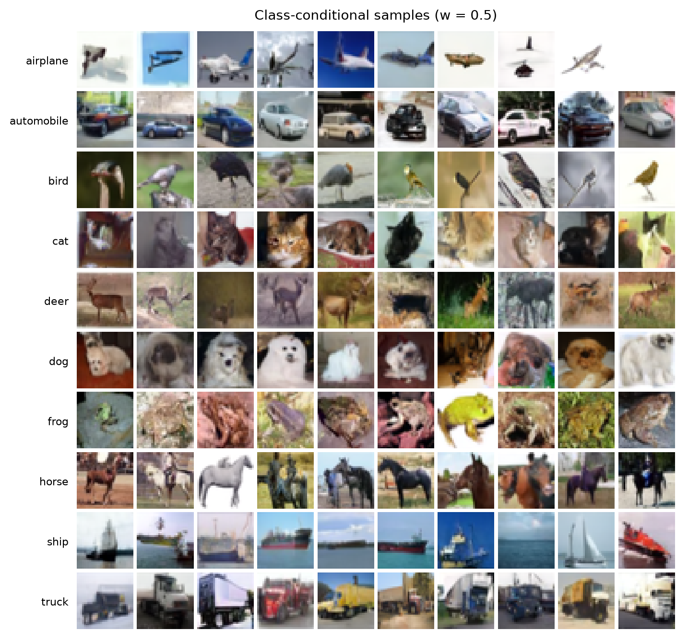
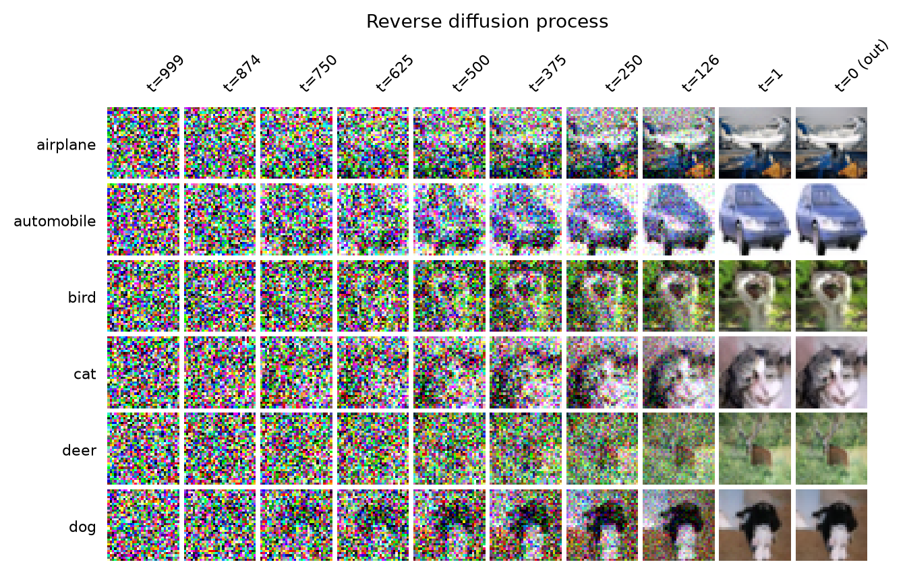
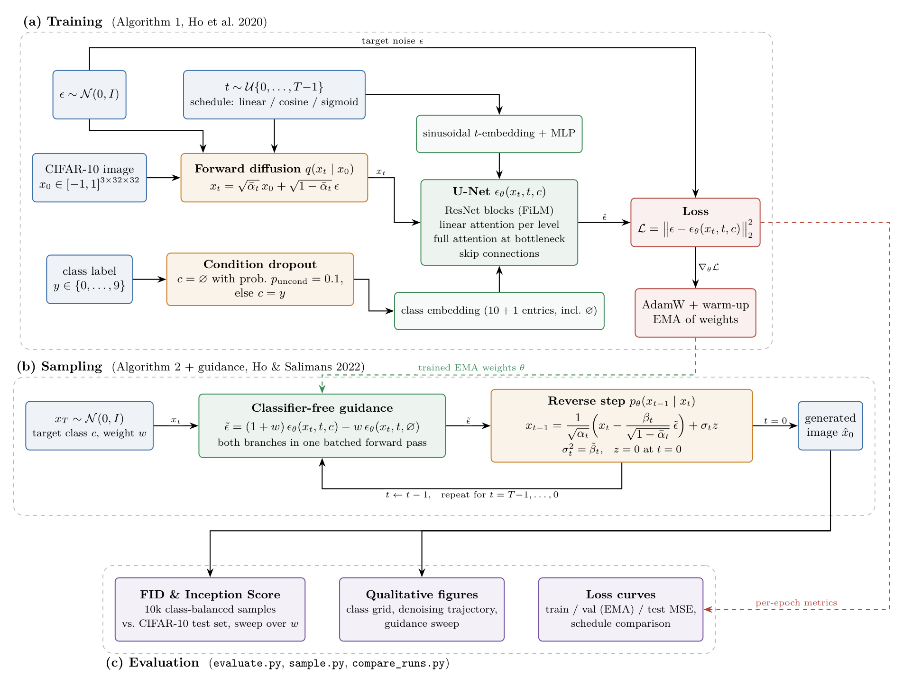
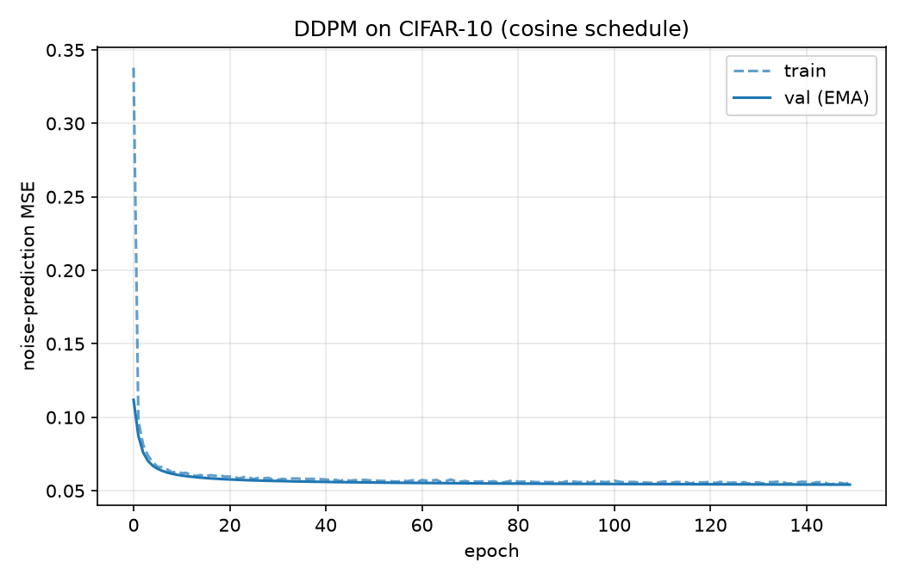
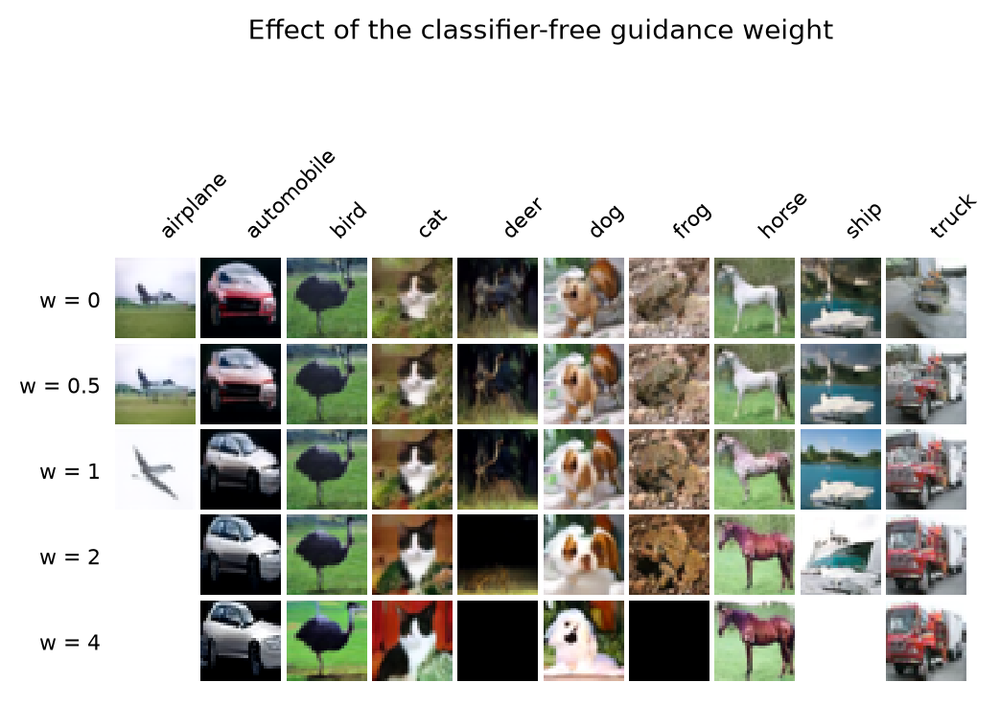
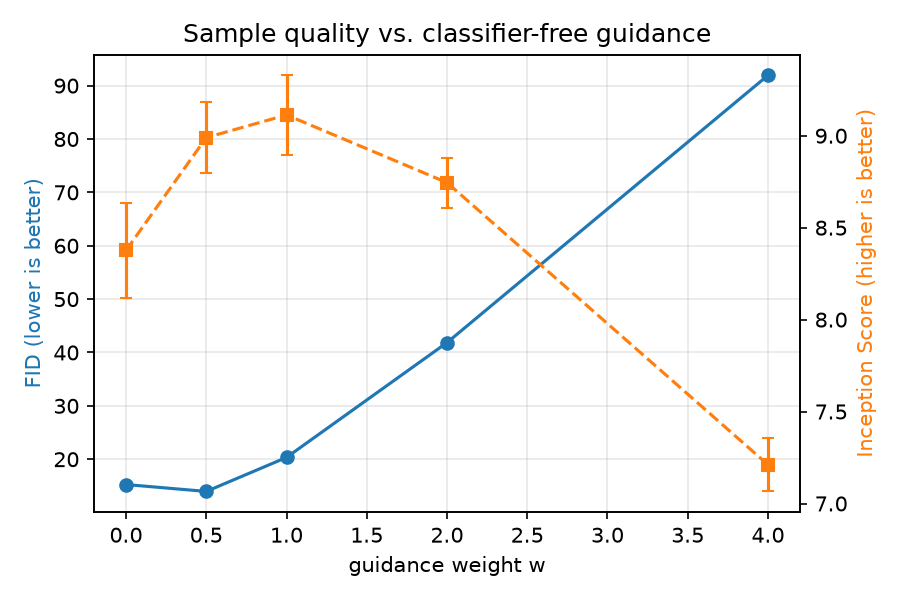

# Class-Conditional DDPM with Classifier-Free Guidance on CIFAR-10

[](https://github.com/anosh-ar/guided-diffusion-cifar10/actions/workflows/tests.yml)


[](LICENSE)

A from-scratch PyTorch diffusion model that **generates new 32×32 images of a chosen class** (airplane, car, bird,
cat, …) from pure noise. It implements DDPM (Ho et al., 2020) with classifier-free guidance (Ho & Salimans, 2022)
and is trained on CIFAR-10.

## Results

**FID 13.97** and **Inception Score 9.11** on CIFAR-10 (10k samples). The model has 10.9M parameters and was trained
for 300 epochs (about 4 hours on a single GPU).

<p align="center">
  
</p>
<p align="center"><sub>Generated images, one row per class. None of them are in the dataset.</sub></p>

<p align="center">
  
</p>
<p align="center"><sub>From noise (left) to image (right): the model removes a little noise at each of 1000 steps.</sub></p>

## How it works



1. **Training:** add a random amount of noise to an image and train a U-Net to predict that noise. The class label
   is hidden 10% of the time, so the network also learns to work without it.
2. **Generation:** start from random noise and let the U-Net remove a little noise, 1000 times. The guidance weight
   `w` sets how strongly the image should match the chosen class.

In more detail:

- **Forward process.** A noisy version of an image at step t can be computed in one go:
  $x_t = \sqrt{\bar\alpha_t}\,x_0 + \sqrt{1-\bar\alpha_t}\,\epsilon$, where $\bar\alpha_t$ comes from the noise
  schedule and $\epsilon$ is Gaussian noise.
- **Training objective.** The U-Net $\epsilon_\theta(x_t, t, c)$ is trained with the mean squared error between the
  true noise $\epsilon$ and its prediction.
- **Classifier-free guidance.** At each sampling step the model predicts the noise twice, with the class $c$ and
  without it ($\varnothing$), and combines the two predictions:
  $\tilde\epsilon = (1+w)\,\epsilon_\theta(x_t, t, c) - w\,\epsilon_\theta(x_t, t, \varnothing)$.
  With `w = 0` this is plain conditional sampling. Both predictions run in one batched forward pass.

### Model and training setup

| | |
|---|---|
| Network | U-Net, 10.9M parameters: ResNet blocks, time and class embeddings, attention at every resolution |
| Diffusion | T = 1000 steps, cosine noise schedule (linear and sigmoid also available) |
| Conditioning | 10 classes + a learned "no class" token; labels dropped with probability 0.1 during training |
| Optimisation | AdamW, learning rate 2e-4 with warm-up, batch size 128, gradient clipping, 300 epochs |
| Stabilisation | exponential moving average (EMA) of the weights, used for evaluation and sampling |
| Efficiency | bfloat16 mixed precision, resumable checkpoints |
| Evaluation | FID and Inception Score on 10,000 samples (1,000 per class) against the CIFAR-10 test set |

<p align="center">
  
</p>
<p align="center"><sub>Training and validation loss (EMA weights) over the first 150 epochs.</sub></p>

The noise-prediction loss levels off early, but this loss is a weak proxy for image quality: diffusion models keep
improving their samples (and FID) long after the loss curve looks flat. For this reason training was run for a fixed
300 epochs instead of being stopped early.

### Guidance weight

| guidance w | FID ↓ | Inception Score ↑ |
|---:|---:|---:|
| 0 | 15.26 | 8.38 |
| **0.5** | **13.97** | 8.99 |
| 1 | 20.34 | **9.11** |
| 2 | 41.85 | 8.75 |
| 4 | 91.93 | 7.21 |

A little guidance helps: `w = 0.5` gives the best FID, and the Inception Score peaks at `w = 1`. Stronger guidance
makes each image look more like its class but reduces variety, and at `w ≥ 2` the colours become over-saturated, so
both scores get worse.

<p align="center">
  
  
</p>

## Quick start

```bash
git clone https://github.com/anosh-ar/guided-diffusion-cifar10.git
cd guided-diffusion-cifar10
pip install torch torchvision --index-url https://download.pytorch.org/whl/cu121   # match your CUDA version
pip install -r requirements.txt

python train.py --schedule cosine --epochs 300 --amp                     # train (CIFAR-10 downloads automatically)
python sample.py --checkpoint runs/<run>/checkpoints/best.pt             # make figures
python evaluate.py --checkpoint runs/<run>/checkpoints/best.pt --amp     # FID / IS
```

To reproduce all results above with one command (training, evaluation and figures):

```bash
EPOCHS=300 SCHEDULES="cosine" bash scripts/reproduce.sh
```

Run `pytest -q` for the unit tests. Every script has `-h` for its options (linear / cosine / sigmoid noise
schedules, model size, guidance weight, …).

## Project structure

```
ddpm/            diffusion process, U-Net, data loading, utilities
train.py         training (EMA, mixed precision, checkpoints, metrics)
sample.py        sample grids, denoising trajectory, guidance sweep
evaluate.py      FID / Inception Score over guidance weights
compare_runs.py  compare several runs (loss curves, summary table)
scripts/         reproduce.sh: train, evaluate and collect figures in assets/
docs/            LaTeX (TikZ) source of the pipeline diagram
tests/           unit tests
```

## References

- J. Ho, A. Jain, P. Abbeel. [Denoising Diffusion Probabilistic Models](https://arxiv.org/abs/2006.11239). NeurIPS 2020.
- J. Ho, T. Salimans. [Classifier-Free Diffusion Guidance](https://arxiv.org/abs/2207.12598). NeurIPS Workshop 2021.
- A. Nichol, P. Dhariwal. [Improved Denoising Diffusion Probabilistic Models](https://arxiv.org/abs/2102.09672). ICML 2021.

## Acknowledgements

The U-Net building blocks are adapted from Phil Wang's
[denoising-diffusion-pytorch](https://github.com/lucidrains/denoising-diffusion-pytorch) (MIT), through
[The Annotated Diffusion Model](https://huggingface.co/blog/annotated-diffusion). The project started in the
*Advanced Deep Learning* course at FAU Erlangen-Nürnberg (winter semester 2023/24).

## License

[MIT](LICENSE)
