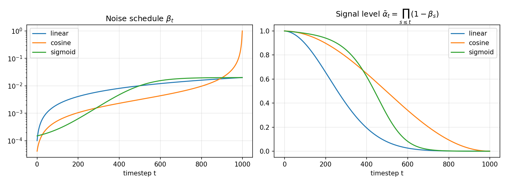

# Class-Conditional DDPM with Classifier-Free Guidance on CIFAR-10

[](https://github.com/anosh-ar/guided-diffusion-cifar10/actions/workflows/tests.yml)


[](LICENSE)

A from-scratch PyTorch implementation of **Denoising Diffusion Probabilistic Models** (Ho et al., 2020) with
**classifier-free guidance** (Ho & Salimans, 2022), trained on CIFAR-10. It includes three noise schedules
(linear, cosine, sigmoid), EMA weights, and a full evaluation pipeline: FID and Inception Score across guidance
weights, loss curves, and qualitative figures.


<sub>Diagram source: [`docs/pipeline.tex`](docs/pipeline.tex) (TikZ).</sub>

## Highlights

- **Conditional U-Net** (≈10.9M parameters) with ResNet blocks, FiLM conditioning on time and class embeddings, linear attention at every resolution and full attention at the bottleneck.
- **Classifier-free guidance.** A learned null-class token. Labels are dropped with probability `p_uncond = 0.1` during training. At sampling time both branches run in a single batched forward pass.
- **Noise schedules:** linear, cosine (Nichol & Dhariwal, 2021) and sigmoid.
- **Training:** AdamW with warm-up, gradient clipping, EMA of the weights, optional bf16 mixed precision, resumable checkpoints, per-epoch CSV logging.
- **Evaluation:** FID and IS (torchmetrics / InceptionV3) on 10k class-balanced samples, swept over the guidance weight `w`; validation and test loss with a fixed noise seed; loss curves; class grids, denoising trajectories and guidance sweeps.
- **Tests:** unit tests for the schedules, the forward process, guidance and the model. They run on CPU in GitHub Actions.

## Results

> **Note:** run `bash scripts/reproduce.sh` to produce the numbers and figures below. The script writes every
> table and figure into [`assets/`](assets). Paste `assets/results.md` and `assets/schedule_comparison.md`
> into the tables below.

### Sample quality vs. guidance weight

<!-- paste assets/results.md here -->
| guidance w | FID ↓ | Inception Score ↑ |
|---:|---:|---:|
| 0 | – | – |
| 0.5 | – | – |
| 1 | – | – |
| 2 | – | – |
| 4 | – | – |

FID uses 10,000 generated images (1,000 per class) against the CIFAR-10 test set, with 2048-d InceptionV3 features.
Small guidance weights usually give the best FID. Larger weights trade diversity for fidelity: IS goes up, FID gets worse again.

<p align="center">
  
  
</p>

### Samples

| Class-conditional samples (one row per class) | Effect of the guidance weight `w` (same initial noise) |
|:---:|:---:|
|  |  |

**Reverse diffusion**, from pure noise (left) to the final sample (right):


### Noise schedules



<!-- paste assets/schedule_comparison.md here -->
| schedule | best val loss | test loss (EMA) | best FID (at w) |
|---|---:|---:|---:|
| linear | – | – | – |
| cosine | – | – | – |
| sigmoid | – | – | – |

| Schedule | Behaviour |
|---|---|
| **Linear** (`1e-4 → 0.02`) | The original DDPM schedule. The signal ᾱₜ drops quickly, so many late timesteps are almost pure noise and add little to training. |
| **Cosine** | Defined through ᾱₜ ∝ cos²(·). The signal decays almost linearly through the middle of the process and destroys information more slowly. It usually works better at low resolutions such as 32×32. |
| **Sigmoid** (`1e-4 → 0.02`) | Small βₜ early and a sharp rise in the middle. It keeps the image almost clean for longer, then switches to the noisy regime quickly. |

## Installation

```bash
git clone https://github.com/anosh-ar/guided-diffusion-cifar10.git
cd guided-diffusion-cifar10
python -m venv .venv && source .venv/bin/activate
# PyTorch for your CUDA version (example: CUDA 12.1)
pip install torch torchvision --index-url https://download.pytorch.org/whl/cu121
pip install -r requirements.txt
```

CIFAR-10 is downloaded to `./data` on first use. You can change the location with `--data_dir`.

## Usage

**Check the setup** (a couple of batches end to end):

```bash
python train.py --dry_run --timesteps 50
pytest -q
```

**Train:**

```bash
python train.py --schedule cosine --epochs 100 --amp
```

Each run writes to `runs/<run_name>/`:

| File | Content |
|---|---|
| `config.json` | all arguments |
| `metrics.csv` / `loss_curve.png` | per-epoch train loss, validation loss (EMA), learning rate, time |
| `samples/epoch_XXX.png` | EMA samples during training (fixed seed, one row per class) |
| `checkpoints/{best,last}.pt` | best by validation loss / latest (`--resume runs/<run>/checkpoints/last.pt`) |
| `summary.json` | best validation loss, test loss, parameter count, training time |

Main options (see `python train.py -h`):

| Argument | Default | Description |
|---|---|---|
| `--schedule` | `linear` | `linear`, `cosine` or `sigmoid` |
| `--timesteps` | `1000` | diffusion steps T |
| `--epochs` / `--batch_size` / `--lr` | `100` / `128` / `2e-4` | optimisation |
| `--dim` / `--dim_mults` | `64` / `1 2 4` | U-Net width and depth |
| `--p_uncond` | `0.1` | label-dropout probability for classifier-free guidance |
| `--unconditional` | off | train without labels |
| `--ema_decay` | `0.9995` | EMA decay of the weights used for evaluation and sampling |
| `--amp` | off | bf16 mixed precision (recommended on RTX 30xx/40xx and A100) |

**Generate figures:**

```bash
python sample.py --checkpoint runs/<run>/checkpoints/best.pt --guidance_scale 1
# -> runs/<run>/figures/{class_grid,trajectory,guidance_sweep}.png
```

**Evaluate (FID / IS):**

```bash
python evaluate.py --checkpoint runs/<run>/checkpoints/best.pt --num_samples 10000 \
    --guidance_scales 0 0.5 1 2 4 --amp
# -> runs/<run>/eval/{results.json,results.md,fid_vs_guidance.png}
```

**Compare runs:**

```bash
python compare_runs.py runs/cifar10_linear runs/cifar10_cosine runs/cifar10_sigmoid
```

**Reproduce everything.** This trains all three schedules, evaluates them and collects the figures in `assets/`:

```bash
bash scripts/reproduce.sh                                   # defaults: 100 epochs, 3 schedules
EPOCHS=50 SCHEDULES="cosine" bash scripts/reproduce.sh      # quicker variant
scripts/run_in_tmux.sh ddpm bash scripts/reproduce.sh       # detached, survives SSH disconnects
```

The script skips finished steps and resumes unfinished training, so it is safe to re-run.

## Method

**Forward process.** Gaussian noise is added over T steps according to the schedule βₜ. With αₜ = 1 − βₜ and
ᾱₜ = ∏ₛ αₛ, the noised image at step t has the closed form

$$x_t = \sqrt{\bar\alpha_t}\,x_0 + \sqrt{1-\bar\alpha_t}\,\epsilon,\qquad \epsilon\sim\mathcal N(0, I).$$

**Training.** The U-Net learns to predict the noise: $\mathcal L = \lVert \epsilon - \epsilon_\theta(x_t, t, c)\rVert^2$.
The class label `c` is replaced by the null token ∅ with probability `p_uncond`, so one network learns both the
conditional and the unconditional model.

**Sampling with classifier-free guidance.** Starting from $x_T\sim\mathcal N(0,I)$, the two predictions are combined as

$$\tilde\epsilon = (1+w)\,\epsilon_\theta(x_t, t, c) - w\,\epsilon_\theta(x_t, t, \varnothing)$$

and the reverse step is applied: $x_{t-1} = \frac{1}{\sqrt{\alpha_t}}\big(x_t - \frac{\beta_t}{\sqrt{1-\bar\alpha_t}}\tilde\epsilon\big) + \sigma_t z$,
with $\sigma_t^2 = \tilde\beta_t = \beta_t\frac{1-\bar\alpha_{t-1}}{1-\bar\alpha_t}$. `w = 0` is plain conditional sampling.

## Project structure

```
ddpm/
  diffusion.py     beta schedules, forward process, loss, guided reverse process
  model.py         conditional U-Net (time + class embeddings, attention)
  layers.py        helpers (up/downsampling, residual, extract)
  data.py          CIFAR-10 loaders and transforms
  utils.py         EMA, checkpoints, logging, loss-curve plots
  visualize.py     labelled image grids
train.py           training with validation, checkpoints and preview samples
sample.py          qualitative figures from a checkpoint
evaluate.py        FID / IS sweep over guidance weights
compare_runs.py    loss curves and summary table across runs
plot_schedules.py  beta / alpha-bar plots of the schedules
scripts/           reproduce.sh, run_in_tmux.sh
docs/              TikZ source of the pipeline diagram
tests/             pytest unit tests
```

## References

- J. Ho, A. Jain, P. Abbeel. [Denoising Diffusion Probabilistic Models](https://arxiv.org/abs/2006.11239). NeurIPS 2020.
- A. Nichol, P. Dhariwal. [Improved Denoising Diffusion Probabilistic Models](https://arxiv.org/abs/2102.09672). ICML 2021.
- J. Ho, T. Salimans. [Classifier-Free Diffusion Guidance](https://arxiv.org/abs/2207.12598). NeurIPS Workshop 2021.
- E. Perez et al. [FiLM: Visual Reasoning with a General Conditioning Layer](https://arxiv.org/abs/1709.07871). AAAI 2018.
- M. Heusel et al. [GANs Trained by a Two Time-Scale Update Rule Converge to a Local Nash Equilibrium](https://arxiv.org/abs/1706.08500) (FID). NeurIPS 2017.

## Acknowledgements

The U-Net building blocks are adapted from Phil Wang's
[denoising-diffusion-pytorch](https://github.com/lucidrains/denoising-diffusion-pytorch) (MIT), through
[The Annotated Diffusion Model](https://huggingface.co/blog/annotated-diffusion) by Niels Rogge and Kashif Rasul.
The project started as part of the *Advanced Deep Learning* course at FAU Erlangen-Nürnberg (winter semester 2023/24).
It has since been extended with bug fixes, EMA training, a full evaluation pipeline (FID / IS) and documentation.

## License

[MIT](LICENSE)
